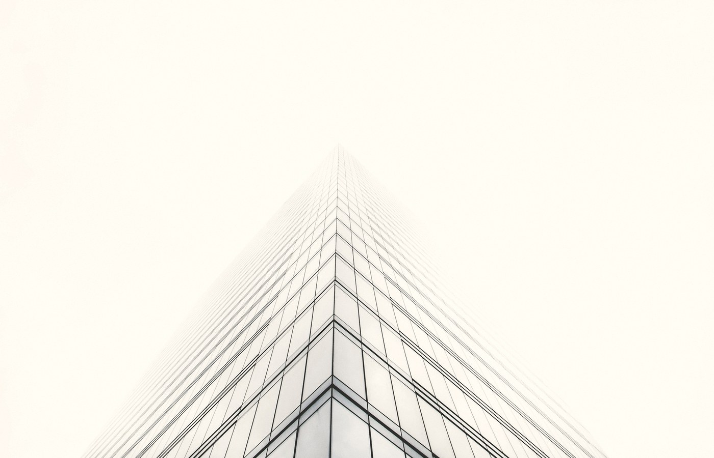

北岸的事务所在一栋旧厂房二层，电梯门一开就是混凝土。他们不要 logo 墙，不要精装宣传册，只要一套「能一直用下去」的东西。

我们从模数开始：所有版面按 3.6 米的柱距换算，纸张尺寸、图纸折法、名片、汇报模板共用同一套比例。这样一来，任何一份文件拿在手里，都像从同一栋楼里取出来的。

> 建筑先有结构，视觉也是。

字体选了一套字重很全的无衬线：标题用极细，正文用常规，行距拉到 1.7 倍——像他们在图纸上留出的空白。颜色只有三种：纸白、石墨灰、一种很浅的砖红，只在剖面图上出现。

*仰拍的玻璃幕墙，取景角度取自他们的剖面图*

## 交付清单

- 一本 42 页的视觉手册，A5，锁线胶装
- 图纸模板与汇报模板（InDesign / Figma 双份）
- 入口铜牌：只做阴刻，不填色

*图纸室，书架按模数重排过一次*

半年后他们发来一张照片：铜牌被摸得发亮。
