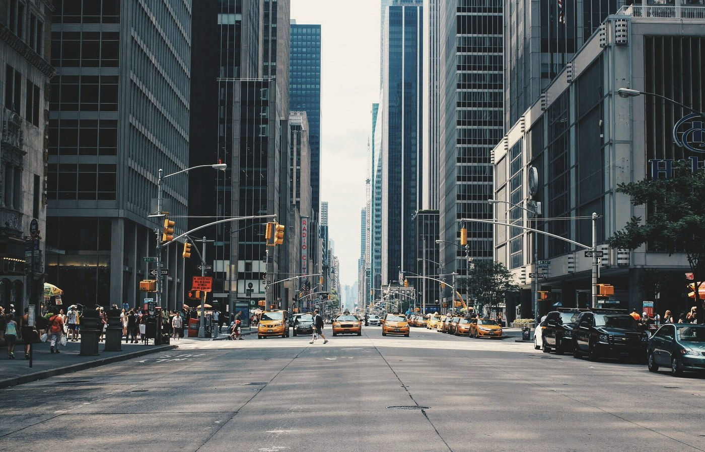

项目开始得没有理由：雨下了 20 天，我出不去，就带着相机出门了。从鼓楼走到拱宸桥，再沿运河往回走，一天两万步。

拍的都是「没什么可拍」的东西：雨棚边缘的水线、便利店门口的伞桶、被车灯照亮的一截斑马线。手机和一台旧胶片机混着用，晚上回家一起扫。

> 城市不是被看见的，是被走出来的。

选片花了三周。最后按路线排，从南到北，不按时间。每张照片下面只有一行字：地点，加上当天走了多少步。

*雨停的间隙，马路像一条刚擦过的镜子*

## 结果

- 36 张照片，一本 96 页的小书，首印 200 本
- 一次社区图书馆的小展览，展期两周
- 书没卖完，剩下的送给了拍摄时遇到的人

*街角红砖楼，下午四点的光*

下一季想走运河的另一头，往北，一直走到看不见高楼为止。