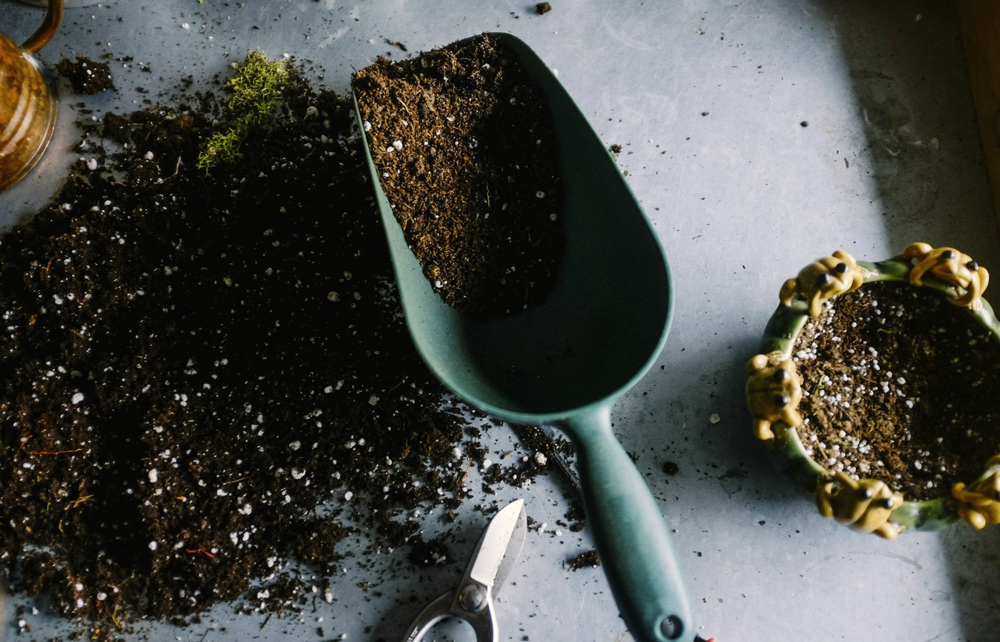
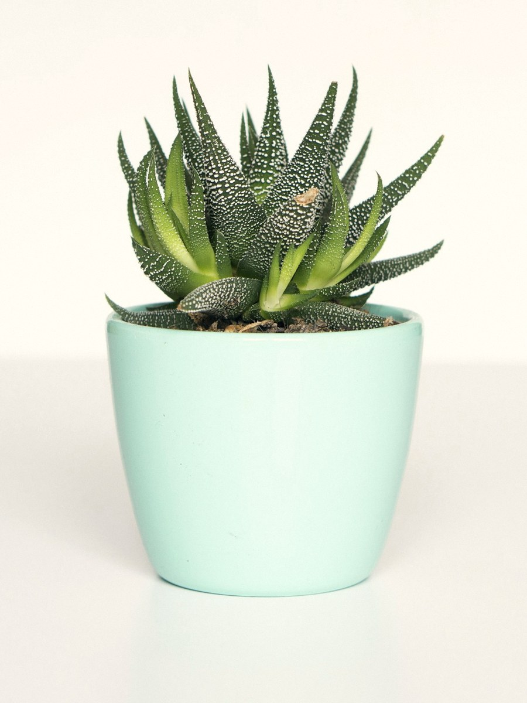

养植物的人不缺知识，缺的是「今天该不该浇水」这一句。篱间不做大而全的植物百科，只做一件事：根据你所在城市的湿度、光照和盆土，每天给一个动作。

产品从一张卡片开始：左边是植物，右边只有一个按钮。按下去，它会告诉你下一次大概是什么时候，然后闭嘴。

> 好的提醒是说完就走，不是留在原地等你表扬。

设计系统里有一组「生长」的动效：浇水时土壤颜色变深，叶片轻微回弹；没有进度条，也没有连续打卡的红点。我们把提醒的文案压缩到 9 个字以内——「今天不用管它」，也算一句。

*阳台实验田，用来记录不同土壤的干湿速度*

## 我负责的部分

- 命名、品牌语气与整套插画
- 组件库与全部状态梳理（空、弱网、休眠）
- 交互动效：Figma → Rive → 前端还原

*第一版插画里的主角，一盆多肉*

上线第三个月，日活里有一半人每天只打开 40 秒。这是我们想要的数字。
