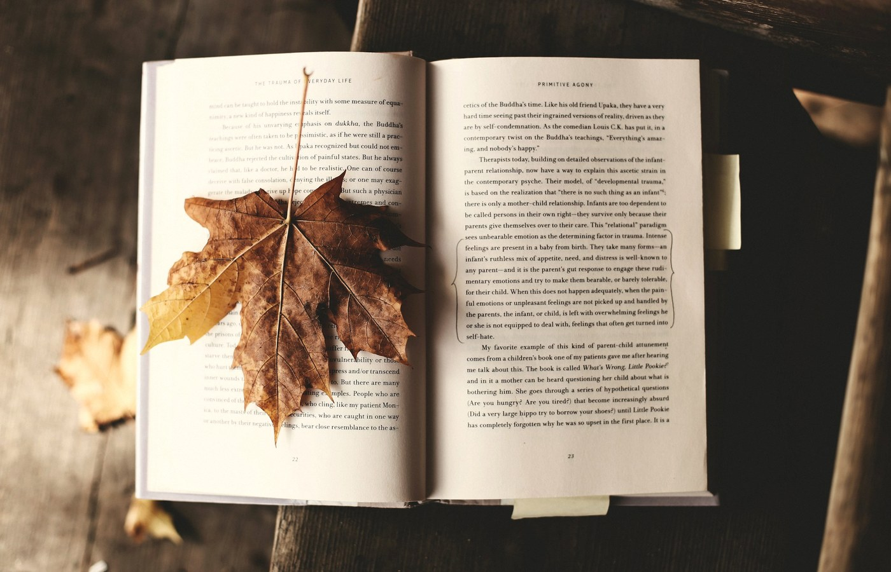
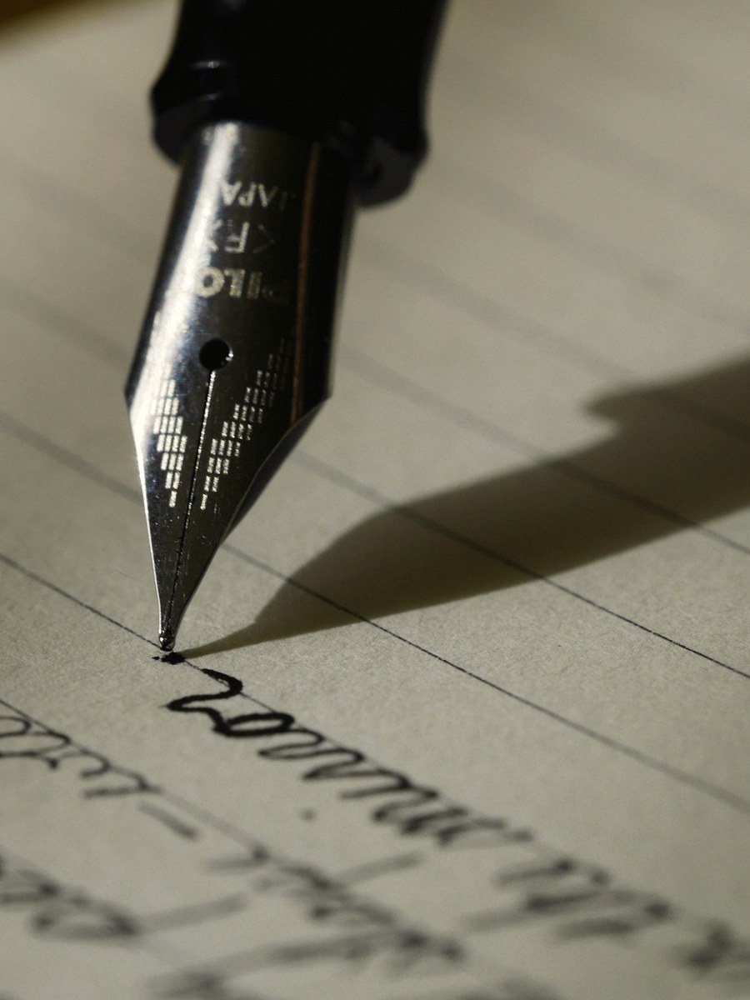

《纸白》是一本每年出一期的独立刊物，不登广告，印量 300 本，编号出售。第一期的主题是「留白」。

我们把正文排成 9pt，行距 1.9，页边距大得让印厂师傅打电话来确认是不是排错了。其实是故意的：想让读者在翻页时先看到纸，再看到字。

> 空白不是没有东西，是还没说话。

印刷用了两种纸：内文 80g 米白胶版，封面 250g 本色卡纸，不覆膜，UV 只压在刊名上。装订试了三次：骑马钉太平，胶装摊不开，最后选锁线胶装。

*内页试印，夹了一片校园里捡的叶子*

## 一些数字

- 4 位作者，11 篇文章，2 组摄影
- 从约稿到上机 5 个月，改版 7 次
- 300 本在两个月内卖完，没有加印

*写刊名用的钢笔，笔尖换过两次*

第二期的稿子已经收了半年。慢一点没关系，纸还在。
