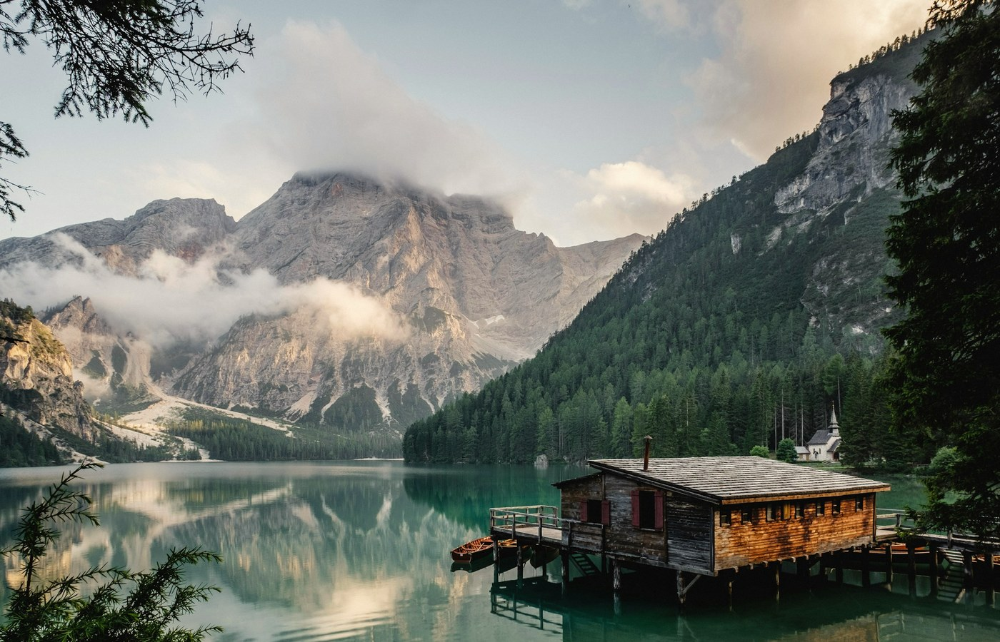

「坞」是四面高、中间低的地方。第一次上山看现场，车停在山脚，走过一段被竹子遮住的路，才看见院子的屋顶。原来的招牌是红底黄字，像高速服务区。

我们决定把它拆回到石头、木头和雾。标志从等高线里来——把院子背后的山脊描下来，删到只剩三根线；颜色只留墨绿、米白，和一种被雨水泡过的灰。茶罐用本地陶土，标签手写，故意不齐。

> 山里的东西不需要被设计得很「高级」，它需要被安静地放回去。

*院子后面的湖，早上六点*

落地时最难的是导视：竹子上不能钉钉子。最后用麻绳和木牌，挂在比视线略低的位置，像谁随手系上去的。

## 一些细节

- 房卡做成木片，边缘保留锯痕
- 早餐单每天手写一张，用完不回收
- 所有印刷品只用两种纸：本色牛皮纸和米白胶版纸

*茶室的下午，一壶本地绿茶*

交付那天下了雨，老板说这样最好，山里本来就是这样。