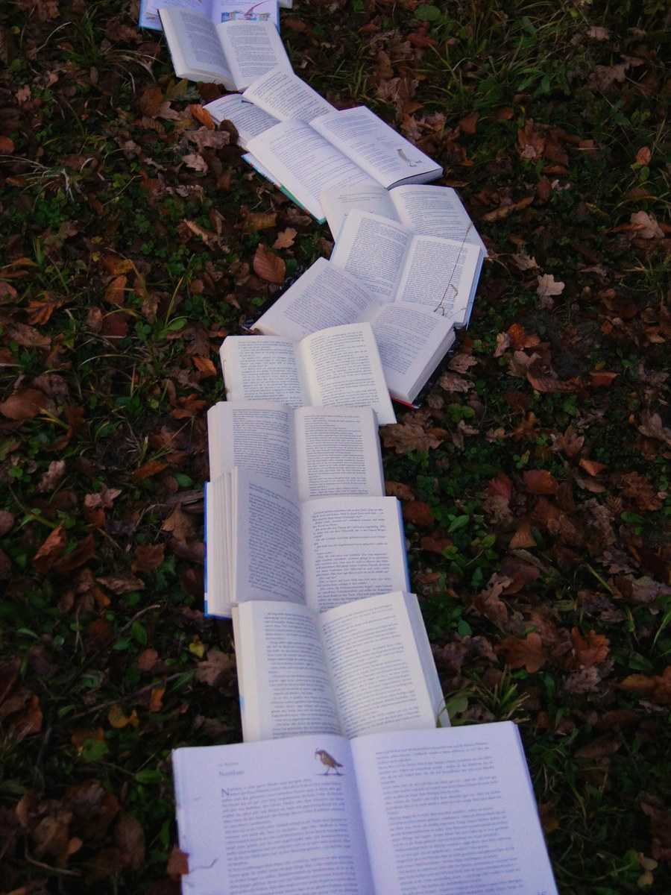

做这个项目，是因为受够了一个又一个要登录、要联网、要订阅的「效率工具」。它们解决的不是问题，是焦虑。

六个工具：压图、转码、算日期间隔、取色、生成渐变、把一段文字排成一行好看的字。全部是单页，断网也能用，不收集任何数据。

> 工具应该像一把好用的螺丝刀：拿起来就能用，用完放回抽屉。

技术上尽量「旧」：原生 JS、Canvas，WebAssembly 只在必要的地方出现；每个页面的打包体积压到 40KB 以内。动效只用 CSS transition，慢、短、不抢戏。

*便利贴上的第六个工具，还没开始做*

## 现在的状态

- 3 个已上线，2 个在做，1 个只画了草图
- 没有任何统计代码，也没有 cookie 提示
- 有人在 GitHub 上提了 12 个 issue，我回了 12 次

*早期的手工纸模，用来试工具卡片的厚度*

订阅按钮不会出现。做完这些，就去做下一个。